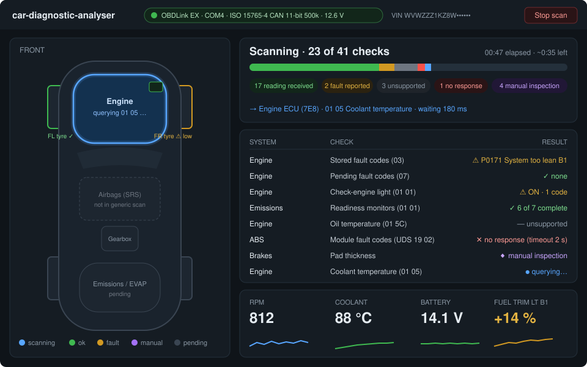
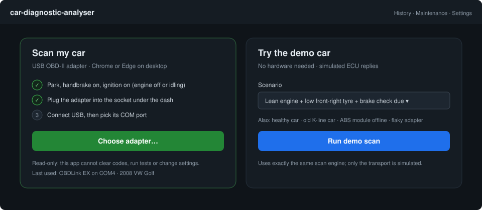
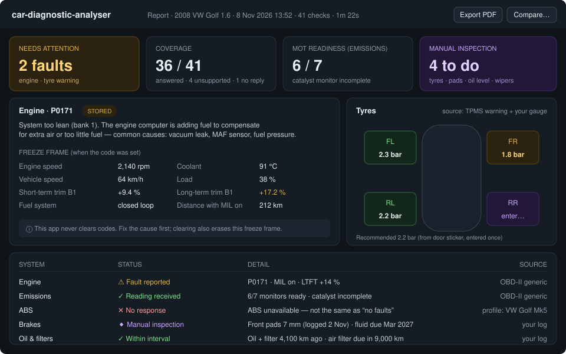
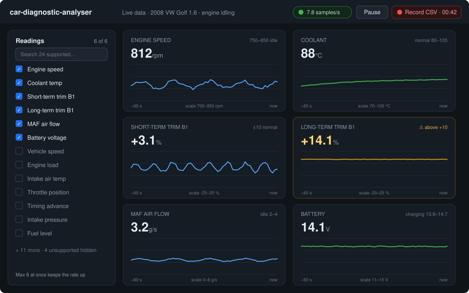
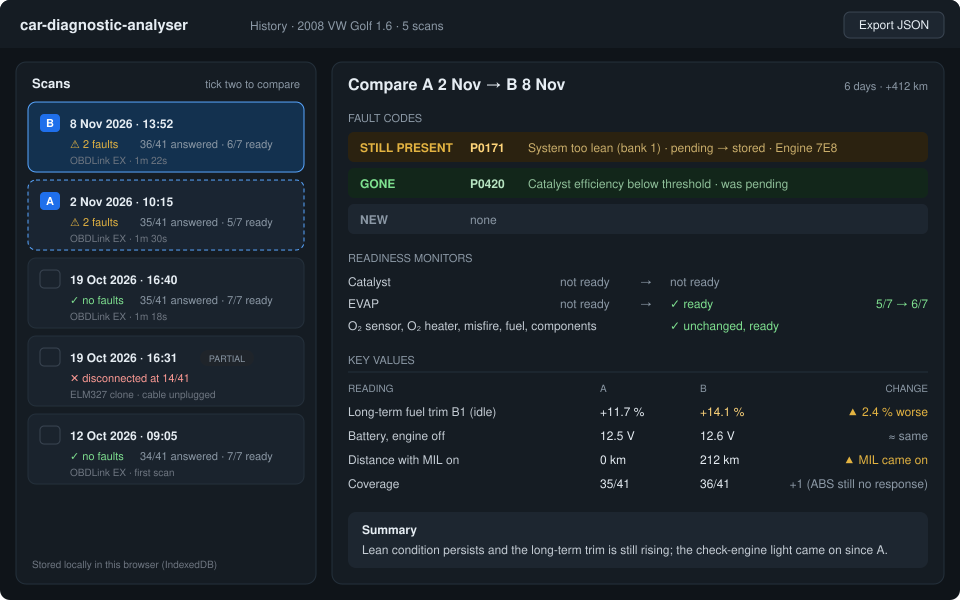
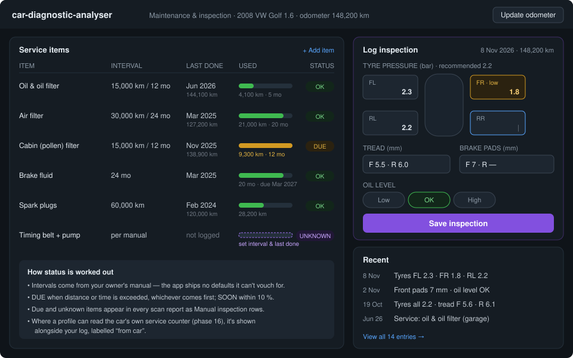

# car-diagnostic-analyser

Browser-based, **read-only** car diagnostics over a USB OBD-II adapter.

Plug a USB OBD-II adapter into your car and your laptop, open the app in Chrome or Edge, and press **Run scan**. A top-down car diagram lights up system by system while a counter shows exactly how many checks have run and what each one returned. When it finishes you get a report that separates what the car **told us** from what **needs a human to look at**.

> **Status:** design phase — no application code yet. The full design is in [design.html](design.html) / [design.pdf](design.pdf).



---

## Contents

- [Features](#features)
- [What it checks](#what-it-checks)
- [How a scan works](#how-a-scan-works)
- [Screens](#screens)
- [Read-only by design](#read-only-by-design)
- [Hardware and compatibility](#hardware-and-compatibility)
- [Getting started (planned)](#getting-started-planned)
- [Project structure (planned)](#project-structure-planned)
- [Tech stack](#tech-stack)
- [Roadmap](#roadmap)
- [Design documents](#design-documents)
- [Limitations](#limitations)
- [FAQ](#faq)
- [Safety](#safety)
- [License](#license)

---

## Features

- **One-click full scan** of everything the connected car exposes, with a live, honest progress counter: *"23 of 41 checks · ABS no response"*.
- **Animated car diagram** — the zone being queried pulses; each zone ends up green, amber, red or purple.
- **Fault codes** (stored, pending, permanent) with plain-English explanations, common causes and the **freeze frame** captured when the fault happened.
- **Emissions readiness monitors** — handy before an MOT.
- **Live data** — up to six readings at once (RPM, coolant, fuel trims, MAF, battery …) with charts and CSV recording.
- **Maintenance and inspection log** for things no computer in the car knows: brake pads, filters, fluids, tyre gauge readings, tread depth.
- **History and compare** — see which codes are new, still present or gone between two scans.
- **Report export** to PDF; full data backup as JSON.
- **Demo car** — a built-in simulator with realistic scenarios, so anyone can try the app without hardware.
- **Local only** — no account, no server; everything stays in your browser.

## What it checks

Generic OBD-II (EOBD in Europe) only guarantees emissions-related data from the engine computer. Other systems need manufacturer-specific requests, which the app adds through **vehicle profiles**, one car at a time. Every result shows its source.

| System | What's checked | Source | Available from |
|---|---|---|---|
| Engine | Stored / pending / permanent fault codes, check-engine light, freeze frame, distance driven with the light on | Generic OBD-II | v0.1 |
| Emissions | Readiness monitors: catalyst, O₂ sensors, EVAP, EGR, misfire, fuel system … | Generic OBD-II | v0.1 |
| Live engine data | RPM, speed, coolant & intake temperature, load, throttle, MAF/MAP, fuel trims, timing | Generic OBD-II (where supported) | v0.1 |
| Battery / charging | Voltage at the socket, engine off and running | Adapter / generic | v0.1 |
| Vehicle identity | VIN, ECU name, calibration IDs | Generic OBD-II | v0.1 |
| Oil, filters, fluids, pads, tyres | Service intervals and your inspection entries | Your maintenance log | v0.2 |
| ABS / brakes | ABS module fault codes, pad-wear warnings where fitted | Vehicle profile | v0.3+ |
| Tyre pressures | Per-wheel pressure on cars with *direct* TPMS (indirect systems only have a warning light) | Vehicle profile | v0.3+ |
| Oil life | The car's own oil-life / service-due counter | Vehicle profile | v0.3+ |
| Gearbox, airbags, body | Module fault codes | Vehicle profile | later |

## How a scan works

```
Connect ─► Discover ─► Plan ─► Run ─► Report
```

1. **Connect** — open the adapter's serial port and run its start-up commands; read battery voltage.
2. **Discover** — detect the car's protocol, read the VIN, ask which readings the car supports, find which modules answer.
3. **Plan** — build the list of checks for *this* car, so the total **N** is known before anything runs.
4. **Run** — one request at a time, with timeouts and a retry; every check updates the counter, the diagram and the list.
5. **Report** — saved locally with the raw request/response log, so results can be re-decoded later if a decoder improves.

Cancel or unplug at any point and you still get a **partial report**.

### Result statuses

| Status | Meaning |
|---|---|
| ✓ **Reading received** | The car answered and nothing is abnormal |
| ⚠ **Fault reported** | Codes present, check-engine light on, or a value out of range |
| — **Unsupported** | This car doesn't provide that reading |
| ✕ **No response** | The module didn't answer — *we don't know*, which is never treated as OK |
| ◆ **Manual inspection** | Can't be read electronically; comes from your inspection log |

"ABS · no response" and "ABS · checked, no faults" are different outcomes and are always worded differently.

## Screens

| Connect | Report |
|---|---|
|  |  |
| **Live data** | **History & compare** |
|  |  |
| **Maintenance & inspection** | |
|  | |

Screen-by-screen details: [design/ui-screens.md](design/ui-screens.md).

## Read-only by design

A diagnostic adapter *can* clear codes, run actuator tests, reset modules and change settings. This app can't. Every request goes through a single **read-only guard** with a default-deny allowlist; anything not on the list is refused before it reaches the serial port. There is no "advanced mode".

- **Allowed:** reading current data, freeze frames, fault codes, readiness, vehicle info; profile-defined read-only module requests.
- **Always blocked:** clearing codes, actuator / output control, routines, writing settings, security access, ECU reset, flashing.

Full list and the tests that enforce it: [design/safety-allowlist.md](design/safety-allowlist.md).

## Hardware and compatibility

```
Car (ECUs) ─► OBD-II socket ─► USB OBD adapter (ELM327/STN) ─► Laptop ─► Chrome/Edge (Web Serial) ─► app
```

| | Requirement |
|---|---|
| **Adapter** | USB, ELM327-compatible. Recommended: **OBDLink EX** (STN chip). Cheap ELM327 clones work for basics but are less reliable. |
| **Browser** | Chrome or Edge on desktop (Windows, macOS, Linux). Web Serial isn't available in Firefox, Safari or mobile browsers — the demo car works everywhere. |
| **Car** | Any car with an OBD-II / EOBD socket. In the EU: petrol from 2001, diesel from 2004. In the US: 1996 onwards. |
| **Not supported (v1)** | Bluetooth and Wi-Fi adapters, J2534 pass-through devices. |

Drivers, first-connection checklist and a terminal sanity test: [design/hardware-setup.md](design/hardware-setup.md).

## Getting started (planned)

> These commands will work once Phase 1 lands.

```bash
git clone https://github.com/<you>/car-diagnostic-analyser.git
cd car-diagnostic-analyser
npm install
npm run dev          # http://localhost:5173 — open in Chrome or Edge
```

| Command | What it does |
|---|---|
| `npm run dev` | Start the dev server |
| `npm test` | Unit and simulator-driven scan tests (Vitest) |
| `npm run test:e2e` | UI tests against the demo car (Playwright) |
| `npm run build` | Production build to `dist/` (static, deployable to GitHub Pages) |
| `python design/build.py` | Rebuild `design.html` and `design.pdf` from `design/` |

**Without hardware:** open the app and choose **Try the demo car**.
**With a car:** park, handbrake on, ignition on → plug in the adapter → **Choose adapter…** → pick its COM port → **Run scan**.

## Project structure (planned)

```
car-diagnostic-analyser/
├─ design.html, design.pdf   design document
├─ design/                   detail docs, wireframes, build script
├─ src/
│  ├─ transport/             ElmSerialTransport (Web Serial), SimulatorTransport
│  ├─ protocol/              OBD-II & UDS codecs, ISO-TP, DTC and PID decoders
│  ├─ guard/                 ReadOnlyGuard + allowlist
│  ├─ scan/                  discovery, planner, runner, events
│  ├─ profiles/              generic-obd2.json, vehicles/*.json
│  ├─ data/                  IndexedDB repositories and migrations
│  └─ ui/                    screens, car diagram, components
├─ sim/scenarios/            demo-car and test scenarios (JSON)
└─ tests/
```

Architecture, interfaces and event model: [design/architecture.md](design/architecture.md).

## Tech stack

| Concern | Choice |
|---|---|
| Language / build | TypeScript (strict), Vite |
| UI | React, CSS modules, inline SVG car diagram |
| Charts | uPlot |
| Hardware access | Web Serial API |
| Storage | IndexedDB via `idb` |
| Tests | Vitest, Playwright |
| Hosting | Static site (GitHub Pages) |

## Roadmap

### v0.1 — Generic engine scan with live progress
1. Project skeleton, simulator and progress UI
2. USB connection over Web Serial + read-only guard
3. Discovery: protocol, VIN, supported readings, battery voltage
4. Engine fault codes with descriptions
5. Check-engine light and readiness monitors
6. Freeze-frame data
7. Live data charts
8. Animated car diagram → **release v0.1**

### v0.2 — History and reporting
9. Save scans, history list
10. Compare two scans
11. PDF / JSON export
12. Maintenance and inspection log

### v0.3+ — Beyond generic OBD-II
13. Vehicle profiles, first make/model/year
14. ABS fault codes
15. Per-wheel tyre pressures
16. Oil life / service counters

Acceptance criteria for each phase: [design/roadmap.md](design/roadmap.md).

## Design documents

| Document | Contents |
|---|---|
| [design.html](design.html) / [design.pdf](design.pdf) | The full design with diagrams and mockups |
| [design/architecture.md](design/architecture.md) | Layers, interfaces, scan engine, events, timing |
| [design/safety-allowlist.md](design/safety-allowlist.md) | Allowed and blocked requests |
| [design/obd-reference.md](design/obd-reference.md) | Adapter commands, PID formulas, DTC decoding, UDS basics |
| [design/data-model.md](design/data-model.md) | Entities and IndexedDB stores |
| [design/ui-screens.md](design/ui-screens.md) | Screens, diagram zones, status wording |
| [design/hardware-setup.md](design/hardware-setup.md) | Adapter, drivers, first connection |
| [design/testing-and-simulator.md](design/testing-and-simulator.md) | Test strategy, scenario format, demo cars |
| [design/roadmap.md](design/roadmap.md) | Phases and acceptance criteria |
| [design/decisions.md](design/decisions.md) | Decision log |

## Limitations

- Generic OBD-II covers the engine and emissions systems; everything else depends on a profile for your specific car.
- Some newer cars put a security gateway in front of their modules; those will show as **No response**.
- Some older cars use proprietary protocols for non-engine modules that ELM327 adapters handle poorly.
- Fault code descriptions are generic; manufacturer-specific codes need a profile table.
- A scan is **not** a roadworthiness or safety inspection. The report lists what wasn't checked.

## FAQ

**Can it clear the check-engine light?**
No, by design. Clearing codes also wipes the freeze frame and the readiness monitors. Fix the cause and the light goes out by itself, or use a garage tool if you need it cleared.

**Why only Chrome and Edge?**
They're the only browsers with the Web Serial API, which lets a web page talk to a USB serial device.

**Will a cheap £10 ELM327 work?**
Often, for basic engine data. Clones vary in quality: some have buggy firmware or misreport their version. An STN-based adapter such as the OBDLink EX is more reliable and faster.

**Why can't it show my tyre pressures?**
Many cars use *indirect* TPMS, which works out pressure loss from ABS wheel speeds and never measures pressure. Cars with *direct* TPMS have sensors in each wheel, and the app can read them once a profile exists for that car. Until then, log gauge readings in the inspection log.

**Does my data leave my computer?**
No. Scans, logs and settings are stored in your browser's IndexedDB. Exports mask the VIN by default.

## Safety

- Only scan with the car **parked, handbrake on and ignition on**. Never while driving.
- Route the cable away from the pedals.
- Unplug the adapter when you've finished; some drain the battery.
- The app warns if battery voltage is below 11.8 V before starting a scan.

## License

See [LICENSE](LICENSE).
