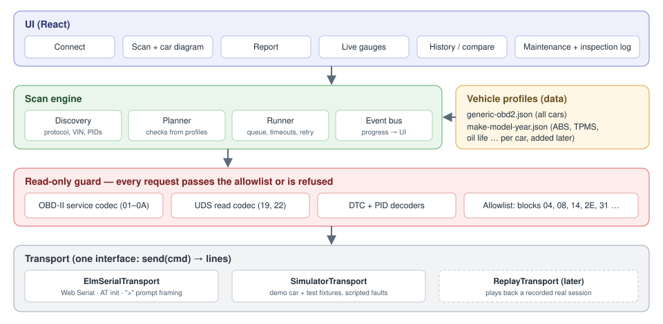
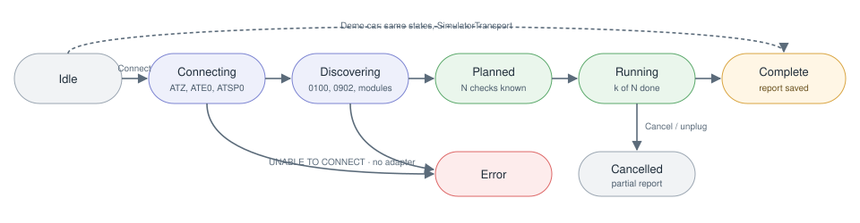

# Architecture



Four layers, each only talking to the one below it:

1. **UI** (React) — subscribes to scan-engine events, never touches the serial port.
2. **Scan engine** — discovery, planning, running checks, emitting progress.
3. **Protocol + read-only guard** — builds and parses OBD-II / UDS messages; every request is checked against the allowlist.
4. **Transport** — moves text lines to and from an ELM327-compatible adapter (real or simulated).

## Transport

```ts
interface Transport {
  readonly kind: 'serial' | 'simulator' | 'replay';
  open(): Promise<AdapterInfo>;                 // runs the AT init sequence
  send(cmd: string, timeoutMs: number): Promise<string[]>; // lines before the '>' prompt
  close(): Promise<void>;
  onDisconnect(cb: () => void): void;
}

interface AdapterInfo { id: string; firmware: string; baud: number; voltage?: number; }
```

### ElmSerialTransport

- `navigator.serial.requestPort()` (user gesture) → `port.open({ baudRate })`, probing 115200 then 38400.
- Writes `cmd + "\r"`; reads and accumulates until the `>` prompt; splits on `\r`, drops empty lines and echoes.
- **One command in flight.** A simple promise queue serialises callers.
- Timeout → sends a single `\r` to abort, waits for `>`, rejects with `TimeoutError`.
- Listens for `navigator.serial` `disconnect` events → scan moves to `Cancelled` with a partial report.
- Logs every exchange `{t, dir: 'tx'|'rx', text}` into the scan's raw log.

### SimulatorTransport

Answers from a scenario file (see [testing-and-simulator.md](testing-and-simulator.md)) with configurable latency, `NO DATA`, timeouts and mid-scan disconnects. Used for the demo car and all integration tests.

## Protocol

```ts
type Request =
  | { kind: 'at'; cmd: string }                                  // "ATRV"
  | { kind: 'obd'; service: number; pid?: number; frame?: number; header?: string }
  | { kind: 'uds'; header: string; sid: 0x19 | 0x22 | 0x3E | 0x10; data: number[] };

type Response =
  | { ok: true; ecus: { ecu: string; bytes: number[] }[] }        // several ECUs can answer 7DF
  | { ok: false; reason: 'NO_DATA' | 'UNABLE_TO_CONNECT' | 'BUS_ERROR' | 'TIMEOUT'
               | 'NEGATIVE' | 'UNKNOWN_CMD'; nrc?: number; raw: string[] };
```

- With headers on (`ATH1`), CAN lines look like `7E8 06 41 05 7B ...`; the parser groups by ECU id and reassembles ISO-TP multi-frame responses (first frame `10 xx`, consecutive `21`, `22` …).
- UDS `7F <sid> 78` (response pending) → keep waiting up to 5 s, don't count as failure.
- Decoders are pure: `decodePid(pid, bytes) → { value, unit }`, `decodeDtcs(service, bytes) → Dtc[]`.

## Read-only guard

`ReadOnlyGuard.check(req: Request): void` throws `ForbiddenRequestError` unless the request matches the allowlist. It sits inside the protocol layer, so nothing above it can bypass it, and the transport's `send` is not exported outside `protocol/`. Details: [safety-allowlist.md](safety-allowlist.md).

## Scan engine



### Discovery

1. Adapter: `ATI`, `ATRV` (pin-16 battery voltage).
2. Protocol: `ATSP0` then `0100` (adapter searches) → `ATDPN`.
3. Supported PIDs: `0100`, then `0120`, `0140`, `0160`, … while bit 32 of the previous bitmap is set. Record which ECUs answered (`7E8`, `7E9` …).
4. Vehicle: `0902` VIN, `090A` ECU name (if supported).
5. Profile: match VIN (WMI + model-year char) against `profiles/vehicles/*.json`; else generic only.
6. Profile modules: for each extra module, a cheap "are you there" probe (`3E 00` tester present, or `22 F190` read VIN DID) with a 1 s timeout.

### Planning

```ts
interface CheckPlan {
  id: string;                 // "engine.dtc.stored"
  system: SystemId;           // 'engine' | 'emissions' | 'abs' | 'tyres' | 'brakes' | 'oil' | 'battery' | ...
  zone: ZoneId;               // car-diagram zone to highlight
  label: string;              // "Stored fault codes"
  source: 'generic' | 'profile' | 'manual';
  request?: Request;          // absent for manual checks
  ecu?: string;
  evaluate: (r: Response) => CheckOutcome;
}
```

The planner emits checks in a fixed order that looks good on the diagram (engine → emissions → battery → profile modules front-to-back → manual items) and **always knows N before running**. Unsupported PIDs (from the bitmap) are still added as checks with status `unsupported` decided immediately, so the user sees them counted.

### Running

- Sequential; per-check timeout (engine 1 s, other modules 2 s), one retry on `TIMEOUT` / `BUS_ERROR`.
- Cancel token checked between checks.
- Each check emits `check:start` then `check:result`.
- ETA = remaining checks × moving average of the last 10 durations.

### Outcome statuses

| Status | Rule |
|---|---|
| `ok` (Reading received) | Valid reply, no codes, values within normal range |
| `fault` (Fault reported) | ≥1 DTC, MIL on, or a value outside the normal range defined in the profile |
| `unsupported` | Not in the PID bitmap, `NO DATA` to a supported-looking request, or UDS NRC 0x11 / 0x12 / 0x31 |
| `no_response` | Timed out after retry, bus error, module didn't answer the probe |
| `manual` | No electronic source; status comes from the inspection log (due / logged / not logged) |

Zone status on the diagram = worst of its checks, ordered `fault > no_response > manual > ok > unsupported`.

### Events

```ts
type ScanEvent =
  | { type: 'scan:planned'; total: number; checks: CheckPlan[] }
  | { type: 'check:start'; checkId: string; t: number }
  | { type: 'check:result'; checkId: string; status: Status; value?: unknown; dtcs?: Dtc[]; durationMs: number }
  | { type: 'live:sample'; pid: number; value: number; unit: string; t: number }
  | { type: 'scan:done'; scanId: string; partial: boolean }
  | { type: 'scan:error'; stage: 'connect' | 'discover' | 'run'; message: string; recoverable: boolean };
```

Implemented as a typed `EventTarget`; the UI keeps a reducer that turns events into view state, which makes the scan screen easy to test by replaying events.

## Live data

After a scan (or from the Live screen), poll up to 6 supported PIDs round-robin. On CAN, several PIDs can go in one request (`01 0C 05 0D`, max 6) to raise the sample rate. Target ≥ 5 samples/s overall on an STN adapter.
